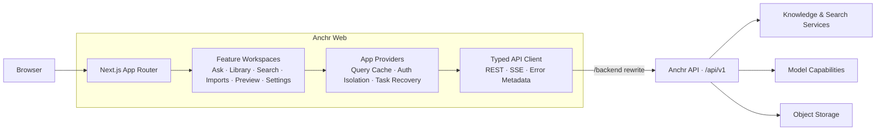

<div align="center">

# Anchr Web

### Anchor your knowledge. Trust every answer.

**A modern, evidence-first workspace for knowledge search, document intelligence, and AI-assisted answers.**

[](https://nextjs.org/)
[](https://react.dev/)
[](https://www.typescriptlang.org/)
[](https://tailwindcss.com/)
[](https://pnpm.io/)
[](./LICENSE)

English · [简体中文](./README.zh-CN.md)

</div>

---

<!--
  Product screenshot

  1. Save the final screenshot as docs/images/anchr-workspace.png.
  2. Recommended size: 1600 × 900 (16:9), ideally showing Ask, citations, and Agent Activity.
  3. Remove the opening and closing comment markers to display the image on GitHub.

  
-->

## About Anchr

Anchr Web is the frontend workspace for the Anchr knowledge system. It brings knowledge-base management, document ingestion, hybrid search, streaming answers, citation preview, and model configuration into one focused interface—so teams can find answers quickly and still understand where each answer came from and how it was produced.

Built with the Next.js App Router and React, the application is designed around real asynchronous and agentic workflows. Long-running tasks can recover after a refresh, streamed answers reconcile with persisted state, citations navigate back to source context, and guest, user, and administrator capabilities remain clearly separated.

> [!IMPORTANT]
> This repository contains the Web frontend only. A compatible Anchr API exposing `/api/v1` is required; the default backend address is `http://127.0.0.1:8080`.

## Features

| Workspace | What it provides |
| --- | --- |
| **Ask** | Ask across knowledge bases or selected documents with traditional RAG or Agent execution, SSE streaming, conversation history, answer modes, and execution traces. |
| **Library** | Create and manage knowledge bases; inspect documents, indexing state, health, recent questions, and recent citations. |
| **Search** | Search across knowledge bases, combine ranked results with an AI answer, and open every citation in its source context. |
| **Imports** | Upload through object storage, track upload, parsing, embedding, and askable stages, retry failures, and recover background work. |
| **Preview** | Preview documents and retrieved segments while preserving navigation context between answers, citations, and the library. |
| **Settings** | Configure Generation, Embedding, Rerank, multimodal Embedding, object storage, indexes, and access tokens. |

## Design principles

- **Evidence first** — answers, search results, and citations stay connected to their source documents.
- **Built for long-running work** — imports and Agent runs expose background state, recovery, and cancellation.
- **Clear trust boundaries** — guest, user, and administrator permissions are handled consistently, with identity-scoped client state.
- **Observable interactions** — Agent Activity, model calls, latency, tokens, and index health remain visible.
- **Responsive workspace** — optimized for dense desktop workflows without giving up small-screen usability or accessible semantics.

## Tech stack

| Area | Technology |
| --- | --- |
| Framework | Next.js 16 · React 19 · TypeScript 5 |
| Styling & icons | Tailwind CSS 4 · Lucide React |
| Server state | TanStack Query 5 |
| Content rendering | React Markdown · GFM · KaTeX |
| Document preview | PDF.js |
| File upload | Aliyun OSS Browser SDK · STS |
| Transport | REST · Server-Sent Events (SSE) |

## Architecture



The browser only calls `NEXT_PUBLIC_API_BASE_PATH`. During development and deployment, Next.js rewrites `/backend/*` to `ANCHR_API_BASE_URL`, keeping client-side request paths stable and reducing cross-origin configuration.

## Quick start

### Prerequisites

- [Node.js](https://nodejs.org/) `>= 20.9.0`
- [pnpm](https://pnpm.io/) `11.2.2`
- A reachable Anchr API service

### 1. Clone and install

```bash
git clone https://github.com/ryanmeowy/anchr-web.git
cd anchr-web
corepack enable
corepack install
pnpm install
```

### 2. Configure the environment

```bash
cp .env.example .env.local
```

```dotenv
# Backend used by the server-side Next.js rewrite
ANCHR_API_BASE_URL=http://127.0.0.1:8080

# Same-origin API path used in the browser
NEXT_PUBLIC_API_BASE_PATH=/backend
```

| Variable | Required | Default | Description |
| --- | --- | --- | --- |
| `ANCHR_API_BASE_URL` | No | `http://127.0.0.1:8080` | Anchr API origin, read only by the server-side Next.js rewrite. |
| `NEXT_PUBLIC_API_BASE_PATH` | No | `/backend` | Browser-facing API prefix. Keep the reverse proxy or Next.js rewrite in sync if changed. |

### 3. Start development

```bash
pnpm dev
```

Open [http://127.0.0.1:3000](http://127.0.0.1:3000). The root route redirects to `/ask`.

On first launch, the workspace checks for:

1. object-storage configuration;
2. Generation and Rerank models;
3. a text or multimodal Embedding model;
4. a ready Segment index.

If any capability is missing, open **Settings** to finish setup. For elevated permissions, paste a valid `X-Access-Token` in Settings; the token is stored in the current browser's local storage.

## Available commands

| Command | Description |
| --- | --- |
| `pnpm dev` | Start the development server on `127.0.0.1:3000`. |
| `pnpm build` | Create a production build. |
| `pnpm start` | Start the built production server. |
| `pnpm lint` | Run ESLint. |
| `pnpm exec tsc --noEmit` | Run the TypeScript type checker. |
| `pnpm test:ask-markdown` | Verify Ask Markdown, GFM, math, and citation syntax. |
| `pnpm test:ask-recovery` | Verify traditional answer recovery. |
| `pnpm test:ask-activity` | Verify the Agent Activity state model. |
| `pnpm test:background-recovery` | Verify background task recovery. |
| `pnpm test:ingestion-recovery` | Verify ingestion creation and recovery. |

See [`package.json`](./package.json) for the remaining focused test scripts. Before submitting a change, run at least:

```bash
pnpm lint
pnpm exec tsc --noEmit
pnpm build
```

## Project structure

```text
anchr-web/
├── public/                      # Static assets and interactive prototypes
├── prototypes/                  # Visual design explorations
├── src/
│   ├── app/                     # App Router layouts and route entries
│   ├── components/
│   │   ├── app/                 # Global providers, navigation, and setup gates
│   │   ├── shared/              # Shared cross-feature components
│   │   └── ui/                  # Foundational UI state components
│   ├── features/                # Ask, Library, Search, Imports, Preview, Settings
│   ├── lib/                     # API, types, recovery models, cross-page state
│   └── types/                   # Third-party type declarations
├── .env.example
├── next.config.ts
└── package.json
```

## Production deployment

```bash
pnpm build
pnpm start
```

Your deployment platform should:

- provide Node.js `>= 20.9.0`;
- set `ANCHR_API_BASE_URL`;
- expose `NEXT_PUBLIC_API_BASE_PATH` to the browser;
- disable unnecessary proxy buffering for SSE endpoints;
- use HTTPS and protect access tokens, model credentials, and storage credentials in production.

## Contributing

Bug reports, ideas, and Pull Requests are welcome. Start with [GitHub Issues](https://github.com/ryanmeowy/anchr-web/issues), then:

1. fork the repository and create a focused branch from `main`;
2. keep the change scoped and add tests for state models or recovery logic;
3. run lint, type checking, relevant tests, and a production build;
4. explain behavior changes, validation results, and relevant UI screenshots in the Pull Request.

## Support

- Use [GitHub Issues](https://github.com/ryanmeowy/anchr-web/issues) for reproducible bugs and feature requests.
- Do not include access tokens, API keys, storage credentials, or private document content in public issues.

---

<div align="center">

Built with care for answers you can trace.

Copyright © 2026 · Released under the [MIT License](./LICENSE)

</div>
