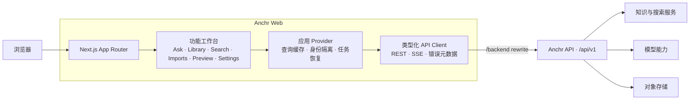

<div align="center">

# Anchr Web

### 锚定知识，信任每一个答案。

**一个面向知识检索、文档智能与可信 AI 问答的现代化工作台。**

[](https://nextjs.org/)
[](https://react.dev/)
[](https://www.typescriptlang.org/)
[](https://tailwindcss.com/)
[](https://pnpm.io/)
[](./LICENSE)

[English](./README.md) · 简体中文

</div>

---

<!--
  项目截图

  1. 将真实界面截图保存为：docs/images/anchr-workspace.png
  2. 推荐尺寸：1600 × 900（16:9），建议展示 Ask 主界面、引用与 Agent Activity。
  3. 删除本注释的开头和结尾，即可在 GitHub README 中显示下方图片。

  
-->

## 关于 Anchr

Anchr Web 是 Anchr 知识系统的前端工作台。它将知识库管理、文档导入、混合检索、流式问答、引用预览和模型配置整合在同一个界面中，让团队不仅能更快获得答案，也能追溯答案来自哪里、如何生成。

项目基于 Next.js App Router 与 React 构建，并围绕真实的长任务和 Agent 工作流设计：页面刷新后可恢复任务状态，流式回答可持续对账，引用可回到原文上下文，访客、用户和管理员拥有清晰的能力边界。

> [!IMPORTANT]
> 本仓库仅包含 Web 前端。完整运行需要一个兼容 `/api/v1` 接口的 Anchr API 服务；默认地址为 `http://127.0.0.1:8080`。

## 核心能力

| 模块 | 能力 |
| --- | --- |
| **Ask** | 基于知识库或指定文档提问；支持传统 RAG 与 Agent 流程、SSE 流式回答、会话历史、回答模式和执行轨迹。 |
| **Library** | 创建与维护知识库，浏览文档、索引状态、健康度、近期问题和近期引用。 |
| **Search** | 跨知识库搜索内容，组合结果与 AI 回答，并从引用直接进入原文预览。 |
| **Imports** | 通过对象存储上传文档，跟踪上传、解析、向量化与可问答阶段，支持失败项重试和后台恢复。 |
| **Preview** | 预览文档与检索片段，在答案、引用和知识库之间保留导航上下文。 |
| **Settings** | 配置 Generation、Embedding、Rerank、多模态 Embedding、对象存储、索引与访问令牌。 |

## 设计原则

- **证据优先**：答案、搜索结果和引用保持关联，便于从结论回到原始文档。
- **面向长任务**：导入和 Agent 执行具备后台状态、恢复与取消能力。
- **边界清晰**：统一处理访客、用户、管理员权限及身份切换后的缓存隔离。
- **可观测交互**：展示 Agent Activity、模型调用、耗时、Token 和索引运行状态。
- **响应式工作台**：为桌面高密度工作流设计，同时保留小屏可用性与无障碍语义。

## 技术栈

| 类别 | 技术 |
| --- | --- |
| 框架 | Next.js 16 · React 19 · TypeScript 5 |
| 样式与图标 | Tailwind CSS 4 · Lucide React |
| 服务端状态 | TanStack Query 5 |
| 内容渲染 | React Markdown · GFM · KaTeX |
| 文档预览 | PDF.js |
| 文件上传 | Aliyun OSS Browser SDK · STS |
| 数据传输 | REST · Server-Sent Events (SSE) |

## 架构



浏览器只请求 `NEXT_PUBLIC_API_BASE_PATH`。开发和部署时，Next.js 会把 `/backend/*` 重写到 `ANCHR_API_BASE_URL`，从而保持前端调用路径一致，并减少跨域配置成本。

## 快速开始

### 环境要求

- [Node.js](https://nodejs.org/) `>= 20.9.0`
- [pnpm](https://pnpm.io/) `11.2.2`
- 可访问的 Anchr API 服务

### 1. 克隆并安装依赖

```bash
git clone https://github.com/ryanmeowy/anchr-web.git
cd anchr-web
corepack enable
corepack install
pnpm install
```

### 2. 配置环境变量

```bash
cp .env.example .env.local
```

```dotenv
# Next.js 服务端用于代理请求的后端地址
ANCHR_API_BASE_URL=http://127.0.0.1:8080

# 浏览器访问 API 时使用的同源路径
NEXT_PUBLIC_API_BASE_PATH=/backend
```

| 变量 | 必填 | 默认值 | 说明 |
| --- | --- | --- | --- |
| `ANCHR_API_BASE_URL` | 否 | `http://127.0.0.1:8080` | Anchr API 地址，仅由 Next.js 服务端重写规则读取。 |
| `NEXT_PUBLIC_API_BASE_PATH` | 否 | `/backend` | 浏览器端 API 前缀。修改后需确保反向代理或 Next.js rewrite 与之匹配。 |

### 3. 启动开发服务器

```bash
pnpm dev
```

打开 [http://127.0.0.1:3000](http://127.0.0.1:3000)。根路径会自动进入 `/ask`。

首次启动时，工作台会检查以下系统能力：

1. 对象存储配置；
2. Generation 与 Rerank 模型；
3. 文本或多模态 Embedding 模型；
4. Segment 索引状态。

如果能力尚未就绪，请进入 **Settings** 完成配置。需要更高权限时，可在 Settings 中粘贴有效的 `X-Access-Token`；令牌会保存在当前浏览器的本地存储中。

## 常用命令

| 命令 | 说明 |
| --- | --- |
| `pnpm dev` | 在 `127.0.0.1:3000` 启动开发服务器。 |
| `pnpm build` | 创建生产构建。 |
| `pnpm start` | 启动已构建的生产服务器。 |
| `pnpm lint` | 运行 ESLint。 |
| `pnpm exec tsc --noEmit` | 执行 TypeScript 类型检查。 |
| `pnpm test:ask-markdown` | 验证 Ask Markdown、GFM、数学公式与引用语法。 |
| `pnpm test:ask-recovery` | 验证传统问答恢复逻辑。 |
| `pnpm test:ask-activity` | 验证 Agent Activity 状态模型。 |
| `pnpm test:background-recovery` | 验证后台任务恢复逻辑。 |
| `pnpm test:ingestion-recovery` | 验证导入任务创建与恢复逻辑。 |

更多聚焦测试脚本请查看 [`package.json`](./package.json)。提交变更前建议至少运行：

```bash
pnpm lint
pnpm exec tsc --noEmit
pnpm build
```

## 项目结构

```text
anchr-web/
├── public/                      # 静态资源与交互原型
├── prototypes/                  # 设计探索原型
├── src/
│   ├── app/                     # App Router、布局与路由入口
│   ├── components/
│   │   ├── app/                 # 全局 Provider、导航与配置门禁
│   │   ├── shared/              # 跨功能共享组件
│   │   └── ui/                  # 基础 UI 状态组件
│   ├── features/                # Ask、Library、Search、Imports、Preview、Settings
│   ├── lib/                     # API、类型、恢复模型与跨页面状态
│   └── types/                   # 第三方类型补充
├── .env.example
├── next.config.ts
└── package.json
```

## 生产部署

```bash
pnpm build
pnpm start
```

部署平台需要：

- 提供 Node.js `>= 20.9.0`；
- 设置 `ANCHR_API_BASE_URL`；
- 允许浏览器访问 `NEXT_PUBLIC_API_BASE_PATH`；
- 为 SSE 流式接口关闭不必要的代理缓冲；
- 使用 HTTPS，并在生产环境中保护访问令牌和模型、存储凭据。

## 参与贡献

欢迎通过 [Issues](https://github.com/ryanmeowy/anchr-web/issues) 报告问题或提出建议，也欢迎提交 Pull Request：

1. Fork 仓库并从 `main` 创建功能分支；
2. 保持改动聚焦，并为状态模型或恢复逻辑补充测试；
3. 运行 lint、类型检查、相关测试与生产构建；
4. 在 Pull Request 中说明行为变化、验证结果和必要的界面截图。

## 获取帮助

- 使用 [GitHub Issues](https://github.com/ryanmeowy/anchr-web/issues) 提交可复现的问题或功能建议。
- 请勿在公开 Issue 中包含访问令牌、API Key、存储凭据或私有文档内容。

---

<div align="center">

为每一个可追溯的答案用心构建。

Copyright © 2026 · 基于 [MIT License](./LICENSE) 发布

</div>
